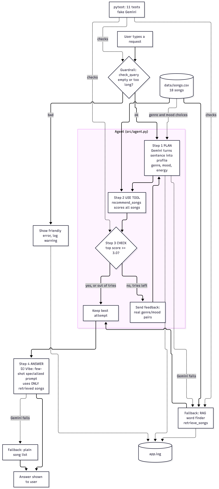

# 🎙️ DJ Vibe: An AI Music Recommender Agent

## Base Project

This project extends my **Module 3 project, "Music Recommender Simulation" (VibeMatch 1.0)**. The original was a content-based recommender: it loaded 18 songs from `data/songs.csv`, scored each song against a hard-coded listener profile (+2 for genre, +1 for mood, up to +1 for energy closeness), and printed the top 5 with reasons. It had no AI, and a real person could not type what they wanted, because the profiles were written inside the code.

## Title and Summary

**DJ Vibe** lets anyone type a music request in plain English, like *"bachata vibes for a date night"*, and get 3 songs from the catalog with a short, friendly explanation.

It combines three AI techniques:

- **RAG (retrieval-augmented generation):** Gemini only explains songs that were retrieved from my real catalog, so it cannot invent fake songs.
- **Agent:** Gemini plans a listener profile, uses my Project 3 scoring function as a tool, checks whether the result is good, and retries with feedback if it is not.
- **Specialized output:** a few-shot "DJ Vibe" prompt gives every answer the same radio-DJ style and format.

**Why it matters:** people describe music with feelings and situations ("rainy study night", "gym", "breakup"), not with numbers like `energy 0.35`. This system translates human requests into the structured data a recommender needs, while staying honest about what is really in the catalog.

## Architecture Overview



Diagram source: [`diagrams/architecture.mmd`](diagrams/architecture.mmd)

1. **Guardrail (`src/guardrails.py`)**: `check_query` blocks empty or too-long requests before any AI call.
2. **Agent loop (`src/agent.py`)**:
   - **PLAN:** Gemini turns the sentence into `{favorite_genre, favorite_mood, target_energy}`, choosing only from the genres and moods that exist in `songs.csv`.
   - **USE TOOL:** `recommend_songs` from `src/recommender.py` (my Project 3 code) scores all 18 songs.
   - **CHECK:** if the top score is below 3.0 (no genre + mood match), the agent tells Gemini which genre/mood pairs really exist and tries again (max 2 tries). It keeps the best attempt.
   - **ANSWER:** `generate_dj_answer` in `src/specialized.py` explains the songs in DJ style, using only the retrieved songs.
3. **Fallbacks:** every Gemini call goes through `safe_ai_call`. If Gemini is down, the agent uses the simple word finder `retrieve_songs` (`src/rag.py`), and the answer falls back to a plain song list instead of crashing.
4. **Logging:** requests, plans, warnings, and errors are written to `app.log`.

## Setup Instructions

1. Clone the repo and enter the folder:
   ```bash
   git clone https://github.com/zawtheinhtike94-glitch/applied-ai-system-project.git
   cd applied-ai-system-project
   ```
2. Create and turn on a virtual environment, then install the requirements:
   ```bash
   python3 -m venv .venv
   source .venv/bin/activate
   pip install -r requirements.txt
   ```
3. Get a free Gemini API key at https://aistudio.google.com/apikey and create a file named `.env` in the project folder:
   ```
   GEMINI_API_KEY=your-key-here
   ```
   (`.env` is in `.gitignore`, so the key is never uploaded.)
4. Run the app and type a request:
   ```bash
   python -m src.ask
   ```
5. Or use the web page (example buttons, DJ answer, top-5 table, and the agent's steps):
   ```bash
   streamlit run app.py
   ```
6. Other commands:
   ```bash
   python -m pytest -q             # 11 automated tests (no internet needed)
   python -m src.evaluate          # evaluation script with live Gemini
   python -m src.compare_styles    # normal answer vs DJ Vibe answer
   ```

## Sample Interactions

### 1. Clear request: strong match on the first try

```
$ python -m src.ask
What kind of music do you want? chill lofi for studying on a rainy night
--- Attempt 1 ---
Step 1 - PLAN: turning your request into a profile...
   Profile: {'favorite_genre': 'lofi', 'favorite_mood': 'chill', 'target_energy': 0.2}
Step 2 - USE TOOL: asking the recommender for songs...
   Library Rain (lofi, chill) score 3.85
   Midnight Coding (lofi, chill) score 3.78
   Focus Flow (lofi, focused) score 2.80
   Spacewalk Thoughts (ambient, chill) score 1.92
   Moonlight Sonata Redux (classical, peaceful) score 1.00
Step 3 - CHECK: is the top song a strong match?
   Yes! Good match found.
Step 4 - ANSWER: asking DJ Vibe to explain the songs...

You're tuned in to DJ Vibe, keeping you company on this rainy night of studying!
🎵 Library Rain - Paper Lanterns | cozy lofi beats for deep focus
🎵 Midnight Coding - LoRoom | smooth late-night rhythms to keep you studying
🎵 Focus Flow - LoRoom | steady instrumental vibes for maximum concentration
Stay tuned, and keep crushing those study goals!
```

### 2. Unknown genre: the agent catches a weak plan and retries

"Bachata" is not in the catalog. The first plan put a workout song (Gym Hero) at #2 for a date night, so the CHECK step rejected it.

```
$ python -m src.ask
What kind of music do you want? bachata vibes for a date night
--- Attempt 1 ---
Step 1 - PLAN: turning your request into a profile...
   Profile: {'favorite_genre': 'pop', 'favorite_mood': 'romantic', 'target_energy': 0.6}
Step 2 - USE TOOL: asking the recommender for songs...
   Sunrise City (pop, happy) score 2.78
   Gym Hero (pop, intense) score 2.67
   Velvet Midnight (r&b, romantic) score 1.90
   Dusty Back Roads (country, nostalgic) score 0.95
   Island Sunday (reggae, laid-back) score 0.88
Step 3 - CHECK: is the top song a strong match?
   No. Best score 2.78 is below 3.0.
--- Attempt 2 ---
Step 1 - PLAN: turning your request into a profile...
   Profile: {'favorite_genre': 'r&b', 'favorite_mood': 'romantic', 'target_energy': 0.6}
Step 2 - USE TOOL: asking the recommender for songs...
   Velvet Midnight (r&b, romantic) score 3.90
   Dusty Back Roads (country, nostalgic) score 0.95
   Island Sunday (reggae, laid-back) score 0.88
   Night Drive Loop (synthwave, moody) score 0.85
   Rooftop Lights (indie pop, happy) score 0.84
Step 3 - CHECK: is the top song a strong match?
   Yes! Good match found.
Step 4 - ANSWER: asking DJ Vibe to explain the songs...

You're tuned in to DJ Vibe, bringing the late-night magic for your date night!
🎵 Velvet Midnight - Solenne | smooth R&B grooves setting a romantic mood
🎵 Night Drive Loop - Neon Echo | moody synthwave beats for the drive
🎵 Rooftop Lights - Indigo Parade | upbeat indie pop to keep the energy glowing
Stay tuned, and keep the good times rolling!
```

### 3. Nothing fits well: the agent stops and warns the user

```
$ python -m src.ask
What kind of music do you want? k-pop dance songs for a party
--- Attempt 1 ---
Step 1 - PLAN: turning your request into a profile...
   Profile: {'favorite_genre': 'pop', 'favorite_mood': 'energetic', 'target_energy': 0.9}
   ...
Step 3 - CHECK: is the top song a strong match?
   No. Best score 2.97 is below 3.0.
--- Attempt 2 ---
   ...
Step 3 - CHECK: is the top song a strong match?
   No. Best score 2.97 is below 3.0.
   Out of tries. Note: these are the closest songs I have, not a perfect match.
Step 4 - ANSWER: asking DJ Vibe to explain the songs...

You're tuned in to DJ Vibe, keeping the dancefloor alive with those high-energy beats!
🎵 Gym Hero - Max Pulse | high-intensity workout pop to fuel the dancefloor
🎵 Block Party Anthem - Kid Kairo | booming hip-hop beats made for heavy grooving
🎵 Neon Pulse - DJ Lumen | pure euphoric edm energy for late-night partying
Stay tuned, and keep the dancefloor moving!
```

Full traces for all three runs are in [`ai_interactions.md`](ai_interactions.md).

### 4. Guardrails: bad input and Gemini failure

Empty input is blocked before calling Gemini:

```
$ python -m src.ask
What kind of music do you want?
Please type what kind of music you want.
```

When Gemini is unavailable (tested with an invalid API key), the app does not crash. It falls back to the word finder and a plain list:

```
--- Attempt 1 ---
Step 1 - PLAN: turning your request into a profile...
   Gemini is not available right now, using the simple finder instead.
Step 4 - ANSWER: asking DJ Vibe to explain the songs...

Here are my picks:
- Library Rain by Paper Lanterns
- Midnight Coding by LoRoom
- Focus Flow by LoRoom
```

And the error is recorded in `app.log`:

```
2026-11-16 12:18:58,329 ERROR AI call plan_profile failed: 400 INVALID_ARGUMENT. {'error': {'code': 400, 'message': 'API key not valid. Please pass a valid API key.', ...}}
```

### 5. Specialized vs. baseline output

Same request and same retrieved songs, two prompts (`python -m src.compare_styles`):

```
=== NORMAL (baseline) ===
Here are 3 cozy tracks from the list that are perfect for studying on a rainy night:

*   **Library Rain by Paper Lanterns** — This gentle lofi track sets a cozy, rainy-day mood with a very relaxed energy.
*   **Midnight Coding by LoRoom** — A chill lofi beat that keeps you in the zone during late-night study sessions.
*   **Spacewalk Thoughts by Orbit Bloom** — A deeply calm and ambient soundscape that helps quiet your mind while you read or write.

=== SPECIALIZED (DJ Vibe) ===
You're locked in with DJ Vibe, bringing you the ultimate rainy night study session!
🎵 Library Rain - Paper Lanterns | cozy lofi beats for deep study hours
🎵 Midnight Coding - LoRoom | smooth instrumental grooves to keep you focused
🎵 Focus Flow - LoRoom | mellow rhythms ideal for getting through tough assignments
Stay tuned, and keep those books open!
```

The specialized version always has a radio intro, exactly 3 songs in the `🎵 Title - Artist | reason` format with short reasons, and a "Stay tuned" sign-off. The baseline uses a different format every time and longer sentences.

## Design Decisions

- **Reuse the Project 3 scorer as the agent's tool.** Instead of letting Gemini rank songs directly, Gemini only fills in a profile and my tested scoring code does the ranking. This keeps the ranking explainable (every score has reasons) and stops Gemini from inventing songs.
- **Give Gemini a fixed menu.** The PLAN prompt lists only the genres and moods found in `songs.csv`, and asks for JSON output. If I add a new genre to the CSV, the agent can use it with no code change.
- **A simple, measurable CHECK.** A top score of 3.0 or more means the song matches both genre and mood. This is easy to test, but it is strict: some reasonable answers (like the k-pop case) never pass.
- **Max 2 tries.** Each try is another Gemini call, which costs time and free-tier quota. More tries rarely helped, because Gemini sometimes repeats the same plan.
- **Few-shot prompting instead of fine-tuning.** Real fine-tuning needs a large dataset and money. A system instruction plus one example answer was enough to give a clearly different, consistent style.
- **`gemini-flash-lite-latest` model.** The larger flash model often returned `503 high demand` errors during development. The lite model was fast and reliable enough for this task.
- **Fail safely.** Every AI call goes through `safe_ai_call`, so a Gemini outage gives a plain answer instead of a crash.

## Testing Summary

**Automated tests: 11 out of 11 pass** (`python -m pytest -q`). The agent tests replace Gemini with a fake function, so they run without internet and give the same result every time.

```
$ python -m pytest -q
...........                                                              [100%]
11 passed
```

| Test area | What is checked |
|---|---|
| Guardrails | empty and 500-character requests are blocked; normal requests are allowed; `safe_ai_call` returns the fallback when the AI raises an error |
| RAG finder | "chill lofi for studying" returns calm lofi songs; "songs for the gym" returns songs with energy above 0.8 |
| Agent | retries after a weak plan and finds Velvet Midnight; keeps the best attempt, not the last; falls back to the word finder when Gemini is down |
| Project 3 | the original 2 recommender tests still pass |

**Evaluation script: 9 out of 9 checks pass** with live Gemini (`python -m src.evaluate`):

```
=== Agent evaluation ===
[PASS] 'chill lofi for studying on a rainy night' -> Library Rain (lofi, chill) score 3.85
[PASS] 'songs for the gym' -> Neon Pulse (edm, euphoric) score 4.00
[PASS] 'bachata vibes for a date night' -> Velvet Midnight (r&b, romantic) score 3.90
[PASS] 'something sad and quiet for a breakup' -> Rainy Window (folk, sad) score 3.90
[PASS] 'angry heavy music to scream to' -> Iron Furnace (metal, angry) score 3.97
[PASS] 'peaceful classical piano to fall asleep' -> Moonlight Sonata Redux (classical, peaceful) score 3.85

=== Guardrail evaluation ===
[PASS] '' blocked: True
[PASS] '     ' blocked: True
[PASS] 'aaaaaaaaaa...' (500 chars) blocked: True

Summary: 9/9 checks passed
```

**What worked:** the agent handled requests with words that are not in my catalog (bachata, breakup, scream, piano) by mapping them to real genres and moods. The guardrails and fallbacks kept the app running during Gemini outages.

**What didn't:** Gemini's answers are not always the same. The bachata request sometimes passes on the first try and sometimes needs the retry. In the k-pop case, Gemini ignored the feedback and repeated the same plan. The `503 high demand` errors were the most common real failure.

**What I learned:** testing AI code needs two kinds of tests: fake-AI unit tests that are repeatable, and live evaluation runs that show how the real model behaves.

## Reflection

This project taught me that an AI system is much more than one call to a model. Most of my work was around the model: giving it the right choices, checking its answer, catching its failures, and being honest with the user when the catalog does not have a good match. I also learned to break a big problem into small steps (setup, retrieval, agent, specialization, guardrails, tests) and to test each step before moving on. My full responsible-AI reflection is in [`model_card.md`](model_card.md).

**What this project says about me as an AI engineer:** I build AI features on top of code I can test and explain, and I care about what happens when the AI is wrong, not only when it is right.
